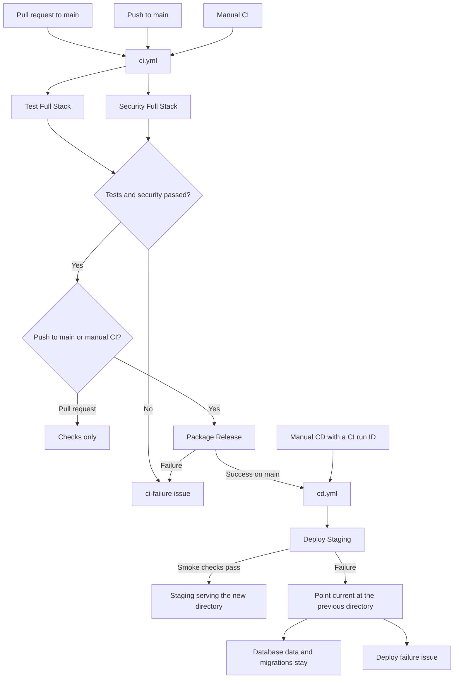
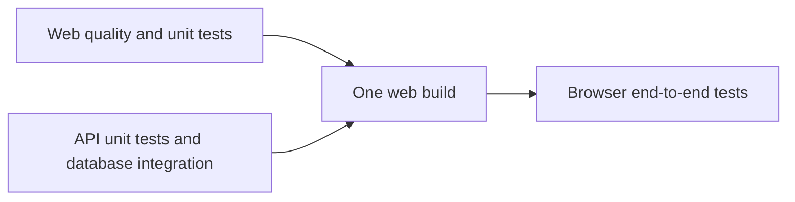
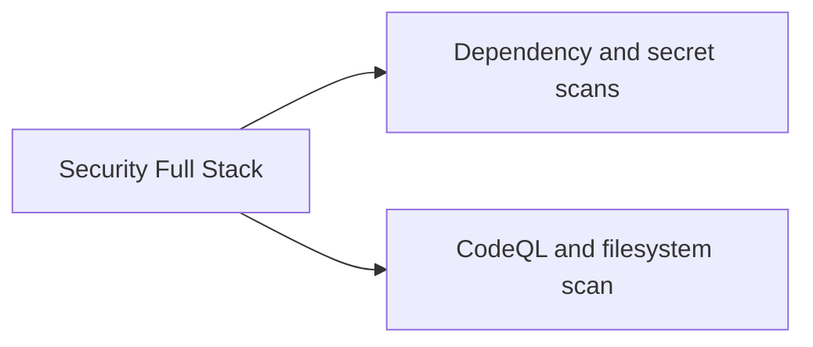
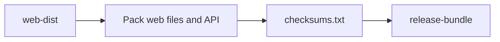
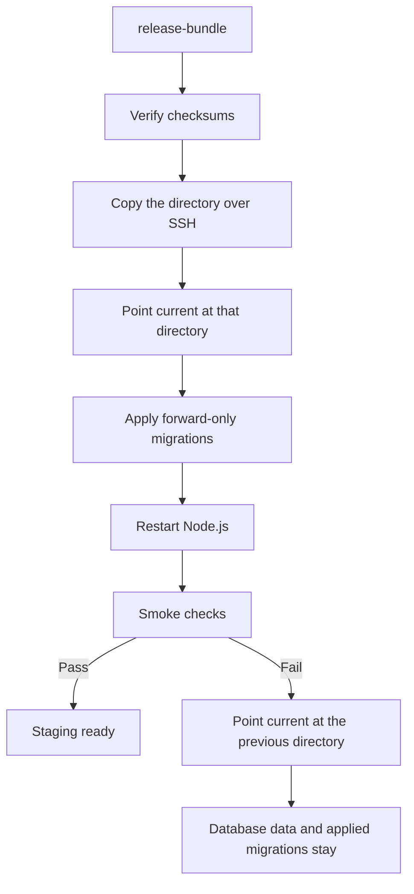

# CI/CD Pipeline

Operational handover: [HANDOVER.md](HANDOVER.md), [SECRETS.md](SECRETS.md), [RUNBOOK.md](RUNBOOK.md), [RELEASE.md](RELEASE.md). Setup steps are in [SETUP-GUIDE.md](SETUP-GUIDE.md).

## Workflow map



GitHub reusable workflows must be placed directly in `.github/workflows`; nested `workflows/reusable/` files are not supported.

Package Release waits until both Test Full Stack and Security Full Stack succeed. A pull request stops after those checks. A successful CI run on `main` starts CD. CD can also be started by hand with the run ID of a successful CI run that uploaded `release-bundle`.

## CI orchestration

### Triggers

| Event | Test | Security | Docker release | Deploy |
| --- | --- | --- | --- | --- |
| PR to `main` | Yes | Yes | No | No |
| Push to `main` | Yes | Yes | Yes | CD after success |
| Manual CI | Yes | Yes | Yes | Run CD with CI run ID |

Concurrency cancels stale CI runs for the same ref. Staging CD is serialized and never cancels an active deployment.

### Tests



Security runs beside the tests, not after them:



[`reusable-test.yml`](../.github/workflows/reusable-test.yml) runs:

1. Web lint, format check, type check, and unit-test coverage.
2. API lint and unit tests.
3. Database service, forward-only migrations, and API integration tests.
4. One production web build, uploaded as `web-dist`.
5. Full host stack and browser end-to-end tests on Chromium, Firefox, WebKit, Mobile Chrome, and Mobile Safari. The API serves the web build on port 4173. PostgreSQL is installed on the runner for that job.

End-to-end checks share `src/config/app-contract.js` with the web service. Page copy can change without rewriting those assertions.

### Security

[`reusable-security.yml`](../.github/workflows/reusable-security.yml) audits both lockfiles and runs verified-secret scanning, CodeQL, and Trivy. Actions are pinned to commit SHAs and permissions are least-privilege.

## Release archive



[`reusable-release.yml`](../.github/workflows/reusable-release.yml) consumes the exact `web-dist` artifact and packs a directory named `YYYY.MM.N-<full-sha>`. The version is the next `YYYY.MM.N` for the current UTC month, counted from release artifacts already stored for that month. `release.json` records the version, full commit SHA, and `runtime: host-node`.

The API dependencies are installed on the runner with `npm ci --omit=dev`, so the server does not need to download packages during deploy.

### Release bundle

The `release-bundle` artifact contains:

- `release.json` — version, full commit SHA, workflow run id, repository
- `release-metadata.json` — the same document
- `checksums.txt` — `sha256sum` of every file in the archive
- `web/` — the built web files
- `api/` — the API, its migrations, and production dependencies
- `deploy-release.sh`, `rollback-release.sh`, `health-check.sh`, `lib/host-process.sh`
- CycloneDX SBOMs for the web and API lockfiles

A second artifact is also uploaded as `release-<CalVer>-<full-sha>` (immutable name; not `latest`).

## CD and staging

[`cd.yml`](../.github/workflows/cd.yml) is triggered by a successful `CI` workflow on `main`, or manually with a successful CI run ID.



Deployment steps:

1. Download the CI `release-bundle`.
2. Enter the `staging` GitHub Environment.
3. Optionally connect the runner with Tailscale.
4. Verify the pinned SSH host key.
5. Verify `checksums.txt` and `release.json`.
6. Copy the archive to `/opt/platform/releases/<version>-<sha>/` when that directory is writable.
7. Record the previous `current` target in `previous-release.json`.
8. Point `/opt/platform/current` at the new directory.
9. Apply forward-only migrations with the Node.js already on the host.
10. Restart the API. It listens on port 4173 and serves both the web files and `/api`.
11. Smoke-test `/`, `/about`, `/contact`, `/api/health`, and `/api/ready`.

CD does not check out the application repository. PostgreSQL is already running on the host. Rollback does not restart or restore it.

### What stays on the host

- Node.js, used only to run the release under `current`
- PostgreSQL on `127.0.0.1`, with its existing data directory
- port 4173, owned by that Node.js process

## Database migration and rollback policy

Migrations are transaction-wrapped, recorded in `schema_migrations`, and forward-only. Application releases must use backward-compatible migrations:

1. add nullable/new structures
2. deploy code using both forms
3. backfill
4. remove old structures in a later release

Rollback points `/opt/platform/current` at the directory recorded in `previous-release.json` and restarts Node.js. Database data and applied migrations are preserved.

## Failure issues and wiki

CI and CD call `scripts/create-failure-ticket.sh`. Issue stages include:

- Full-Stack Tests
- Security Analysis
- Web & API Container Release
- Host Deployment

Issues include direct run links, stage labels, reproduction guidance, and deduplication. The existing `Developer Fix Choice` workflow remains available for approved lint/format fixes or manual remediation.

`scripts/publish-wiki-report.sh` publishes the report index, stage status, artifacts, troubleshooting, and open CI issues. Wiki publishing can be invoked after CD if a `WIKI_TOKEN` is configured.

## Artifacts

| Artifact | Producer | Purpose |
| --- | --- | --- |
| `web-dist` | tests | exact web build consumed by the image release |
| `web-coverage` | tests | web unit-test coverage |
| `playwright-report` | tests | traces/screenshots/report |
| `release-bundle` | release archive | web files, API, checksums, deploy scripts |
| `cd-release` | CD prepare | deployment copy of release bundle |

## Required permissions and secrets

### Staging environment

- `SSH_PRIVATE_KEY`
- `STAGING_HOST`
- `STAGING_USER`
- `STAGING_SSH_KNOWN_HOSTS`
- `POSTGRES_PASSWORD`
- optional `TAILSCALE_AUTHKEY`

### Optional repository secret

- `WIKI_TOKEN` for wiki pushes

## Operations

```bash
# Status
curl -f http://127.0.0.1:4173/api/ready
readlink -f /opt/platform/current

# Logs
tail -n 200 /opt/platform/api.log

# Manual rollback
DEPLOY_ROOT=/opt/platform /opt/platform/rollback-release.sh
```
