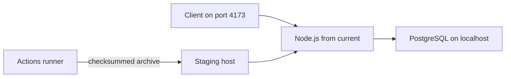

# CI/CD handover

This repository demonstrates a GitHub Actions CI/CD pipeline. The sample workload is a web service, an API service, and a private database. These documents cover how that pipeline tests, scans, releases, and deploys the workload.

## What you are receiving

| Area | Where it lives |
| --- | --- |
| CI on pull requests and `main` | `.github/workflows/ci.yml` plus `reusable-test.yml` and `reusable-security.yml` |
| Image release | `.github/workflows/reusable-release.yml` |
| Staging deploy and rollback | `.github/workflows/cd.yml`, `reusable-deploy.yml`, `reusable-rollback.yml` |
| Deploy scripts shipped inside each release | `scripts/deploy-release.sh`, `rollback-release.sh`, `health-check.sh` |
| Runtime on the server | Node.js and PostgreSQL already installed. CD only copies files and restarts the API. |
| Failure issues | `scripts/create-failure-ticket.sh`, label `ci-failure` |
| Approved lint/format fixes | `.github/workflows/developer-fix-choice.yml` |

GitHub only discovers workflows placed directly under `.github/workflows`.

## Runtime shape

CD copies the archive to `/opt/platform/releases/<version>-<sha>/` and points `/opt/platform/current` at that directory. The host does not download a container image.

Deploy files on the VM live in `/opt/platform` when that directory is writable by the deploy user, otherwise `~/platform`.

## Access the receiving team needs

- Admin on this GitHub repository (Actions, Environments, branch protection).
- A Linux deploy user on the staging host: owner of `/opt/platform`, with `node`, `jq`, and `curl` on the path. PostgreSQL is already installed.
- SSH from GitHub-hosted runners to that host (public address or Tailscale).
- Optional: a fine-grained token with wiki write access if automated wiki reports should publish.

## Read these first

1. [SETUP-GUIDE.md](SETUP-GUIDE.md) — staging host, GitHub `staging` environment, first release.
2. [SECRETS.md](SECRETS.md) — every secret, where it is stored, and how to rotate it.
3. [CI-CD-PIPELINE.md](CI-CD-PIPELINE.md) — workflow map, release bundle, deploy steps.
4. [RELEASE.md](RELEASE.md) — versioning, required checks, migration rules.
5. [RUNBOOK.md](RUNBOOK.md) — status, logs, redeploy, rollback, failure issues.

## First release checklist

1. Create the GitHub Environment named `staging` and add the secrets in [SECRETS.md](SECRETS.md).
2. Prepare the VM as in [SETUP-GUIDE.md](SETUP-GUIDE.md). Confirm `node -v` and that PostgreSQL accepts local connections.
3. Require the pull-request checks listed in [RELEASE.md](RELEASE.md).
4. Open a pull request to `main` and wait for Test Full Stack and Security Full Stack.
5. Merge. CI publishes the release bundle. CD deploys it and rolls back the web and API images if deploy or smoke checks fail.
6. Confirm `http://<staging-host>:4173/api/ready` returns success.

Database data and applied migrations are never rolled back automatically.
